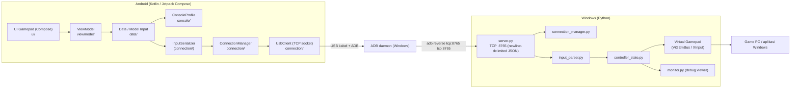

# Arsitektur XboxVirtualController

## Diagram Arsitektur



Alternatif diagram teks (tanpa mermaid):

```
┌─────────────────────── Android ───────────────────────┐
│ UI(Compose) → ViewModel → data → InputSerializer      │
│        → ConnectionManager → UsbClient (socket TCP)   │
└──────────────────────┬────────────────────────────────┘
                       │  USB kabel, trafik diteruskan oleh:
                       │  adb reverse tcp:8765 tcp:8765
┌──────────────────────▼─────────────── Windows ────────┐
│ server.py :8765 → connection_manager → input_parser   │
│     → controller_state → Virtual Gamepad (ViGEm/XInput)│
│                          └→ monitor.py (log debug)     │
└──────────────────────┬────────────────────────────────┘
                       ▼
              Game PC membaca "controller"
```

## Alur Data (end-to-end)

1. **Pengguna menyentuh UI** gamepad di Android (tombol A/B/X/Y, stick, trigger). Compose memanggil callback ViewModel.
2. **ViewModel** memperbarui state input terbaru (bukan mengirim event mentah per sentuhan — state yang dikirim adalah *snapshot* input saat itu, sehingga koneksi lambat tidak menumpuk event).
3. **InputSerializer** mengubah state menjadi satu baris JSON (newline-delimited) — lihat format di bawah.
4. **ConnectionManager** mengelola siklus hidup koneksi (connect/reconnect/keepalive) dan mengirim buffer ke **UsbClient**.
5. **UsbClient** membuka socket TCP ke `127.0.0.1:8765` di ponsel. Karena `adb reverse`, trafik diteruskan ke port 8765 di Windows.
6. **server.py (Windows)** menerima baris JSON (dipisahkan `\n`), memverifikasi `type`, lalu meneruskan ke **input_parser**.
7. **input_parser** memvalidasi & menormalkan nilai (clamp stick [-1,1], trigger [0,1], tombol boolean).
8. **controller_state** menyimpan state gamepad saat ini dan mendorongnya ke virtual gamepad (ViGEm/XInput) — game PC membacanya sebagai controller asli.
9. **monitor.py** menampilkan aliran input real-time untuk debugging.

Frekuensi kirim: ~60 Hz (dibatasi oleh frame dari UI), payload ±200–300 byte per pesan.

## Komponen Android (`android/app/src/main/java/com/haikal/xboxcontroller/`)

| Paket | Komponen | Tanggung jawab |
|---|---|---|
| `connection` | **ConnectionManager** | State machine koneksi (Disconnected → Connecting → Connected), retry otomatis, mengirim payload JSON berkala. Satu-satunya pemilik socket. |
| `connection` | **UsbClient** | Wrapper socket TCP ke `127.0.0.1:8765` (diteruskan ADB ke Windows). Berjalan di coroutine/thread IO, menyediakan `send(line: ByteArray)`. |
| `connection` | **InputSerializer** | Mengubah objek state input → satu baris JSON `{"type":"controller_input", ...}\n`. Menjamin urutan field stabil & newline terminator. |
| `console` | **ConsoleProfile** | Profil target output (mis. `WINDOWS_PC`, `XBOX_ONE`, `XBOX_360`). Untuk V1/V2 hanya `WINDOWS_PC` yang `SUPPORTED`; profil konsol tersedia untuk struktur data tapi statusnya `NOT_SUPPORTED` (lihat compatibility.md). |
| `ui` | Layar Compose | GamepadOverlay, layout tombol/stick, indikator koneksi. |
| `navigation` | NavHost | Routing antar layar (Home → Gamepad → Settings). |
| `data` | Model & repository | Data class `ControllerInput`, `Buttons`, `Stick`, `Triggers`. |
| `viewmodel` | ViewModel | Menjaga state UI, debounce input, memanggil ConnectionManager. |

## Komponen Windows (`windows/`)

| File | Tanggung jawab |
|---|---|
| **server.py** | TCP server asyncio/threaded di port 8765. Menerima klien, membaca baris (`readline`), memisahkan frame dengan `\n`, dispatch ke connection_manager. |
| **connection_manager.py** | Melacak klien aktif (satu gamepad virtual per klien), menangani disconnect/reconnect, broadcast event ke listener (monitor). |
| **input_parser.py** | `parse_controller_input(raw_json) -> ControllerInput`. Validasi `type == "controller_input"`, clamp nilai stick/trigger, abaikan field tak dikenal, raise `InputParseError` untuk payload rusak. |
| **controller_state.py** | Menyimpan snapshot gamepad, dedupe (kirim ke virtual gamepad hanya saat berubah), menerjemahkan ke API virtual gamepad (ViGEm X360 pad atau vJoy), deadzone konfigurabel. |
| **monitor.py** | CLI viewer: menampilkan tombol yang ditekan, posisi stick, nilai trigger secara real-time (baca dari connection_manager). |

## Format JSON (lengkap)

Satu pesan = **satu baris** diakhiri `\n` (newline-delimited). Field wajib `type` untuk dispatch.

```json
{
  "type": "controller_input",
  "console": "WINDOWS_PC",
  "buttons": {
    "A": false,
    "B": false,
    "X": false,
    "Y": false,
    "LB": false,
    "RB": false,
    "View": false,
    "Menu": false,
    "Guide": false,
    "L3": false,
    "R3": false
  },
  "left_stick": {
    "x": 0.0,
    "y": 0.0
  },
  "right_stick": {
    "x": 0.0,
    "y": 0.0
  },
  "triggers": {
    "LT": 0.0,
    "RT": 0.0
  }
}
```

### Aturan nilai

| Field | Rentang | Catatan |
|---|---|---|
| `type` | string literal `"controller_input"` | Wajib; parser menolak nilai lain. |
| `console` | string; `WINDOWS_PC` (SUPPORTED), `XBOX_ONE`/`XBOX_SERIES`/`XBOX_360` (NOT_SUPPORTED) | Menandai profil target; Windows hanya memproses `WINDOWS_PC`. |
| `buttons.*` | boolean | 11 tombol. |
| `left_stick.x/y`, `right_stick.x/y` | float −1.0 … 1.0 | Di-clamp oleh input_parser; y positif = atas. |
| `triggers.LT/RT` | float 0.0 … 1.0 | 0 = dilepas, 1 = ditekan penuh. |

Contoh (menekan A + condong kiri atas + RT penuh):

```json
{"type":"controller_input","console":"WINDOWS_PC","buttons":{"A":true,"B":false,"X":false,"Y":false,"LB":false,"RB":false,"View":false,"Menu":false,"Guide":false,"L3":false,"R3":false},"left_stick":{"x":-0.5,"y":0.8},"right_stick":{"x":0.0,"y":0.0},"triggers":{"LT":0.0,"RT":1.0}}
```

Pesan lain yang mungkin (dari Android): `{"type":"hello","console":"WINDOWS_PC","app_version":"1.0"}` saat koneksi dibuka; Windows membalas `{"type":"welcome","protocol":1}`. Tipe tak dikenal diabaikan dengan log peringatan.
